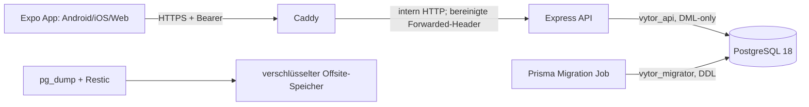

# Vytor – technischer Stack und Architektur

Stand: 22.10.2026, Remediation-Basiscommit `68999e91837e4e2b33d23607d9698f0610aa01ee` plus uncommitteter Code-Release-Kandidat.

## Systemübersicht



## Frontend

- Expo SDK 57.0.31, Expo Router 57.0.29, React Native 0.86.3, React 19.2.3, TypeScript 6.0.3; npm und `package-lock.json`, kein Bun.
- Expo Router 57: alle Screens liegen in `src/app/`, Navigatoren in `_layout.tsx`. Komponenten, Contexts, Hooks und Utilities liegen außerhalb des Route-Verzeichnisses.
- `WorkoutProvider` ist der zentrale Workout-Zustand. Theme und Dialoge haben eigene Contexts. Es gibt keinen Redux-/Query-Cache.
- `src/services/api.ts` kapselt Fetch, 15-Sekunden-Abbruch, Bearer-Header, Session-Reaktion und API-Verträge. Release-JavaScript akzeptiert nur eine explizite HTTPS-URL.
- Workout-Drafts liegen kontogetrennt in AsyncStorage. Eine gemeinsame Sync-Promise serialisiert Flushes, wartet bei Wechsel/Background/Strukturänderung auf laufende Saves und sendet währenddessen entstandene Änderungen in Folgerevisionen. Ergebnisse gelten nur für dieselbe Account-/Workout-/Generation-Identität. Der Status unterscheidet lokalen Write, ausstehende Serversynchronisation, bestätigten Save, Konflikt und Fehler.
- Der Provider besitzt eine Session-Generation für Login/Logout/Expiry/Delete, eine Workout-Generation für aktive Workout-Identität und eine eigene Reload-Sequenz für konkurrierende Reads. Asynchrone Actions erfassen Account, Workout und beide Lifecycle-Generationen vor ihrem ersten Await. Nach jedem Await darf nur die unverändert aktuelle Identität React-State, Revision, Theme, Sync-Status oder Refs verändern. Dadurch ist auch A→B→A eindeutig; gleiche Account-ID bedeutet nicht gleiche Session-Generation.
- `savePreset()` verwendet dieselbe Operation-Identity: Account, Session-Generation und serialisierter Workout-Payload werden synchron erfasst. Danach liefert `captureSessionRequestBinding()` ein atomar gelesenes Account-/Token-Snapshot. Der Fetch-Wrapper vergleicht dieses Snapshot vor dem Netzwerkzugriff mit dem Session-Store und verwendet ausschließlich den gebundenen Token. Ein Sessionwechsel vor Versand verhindert den Request; ein bereits laufender A-Request kann nicht auf Token B umschalten. Späte Ergebnisse dürfen nur in derselben Provider-Generation UI-Feedback auslösen.
- Settings lädt die angezeigten Werte mit einem `SessionRequestBinding` aus Account-ID und Token. Beim Öffnen eines Logout-, Passwort- oder Delete-Dialogs wird die aktuelle Identität atomar gegen dieses Screen-Snapshot geprüft und im Dialog gespeichert. Die spätere Bestätigung darf nur dieses Snapshot verwenden. `deleteAccount()` und `changePassword()` prüfen es im Fetch-Wrapper unmittelbar vor Versand, bereinigen Credentials per vollständigem Identity-Compare und liefern `sessionCleared`; ausschließlich dieses Ergebnis erlaubt Login-Navigation. Ein alter Dialog kann deshalb weder B noch eine neue A-Session mutieren. Ein synchrones In-Flight-Ref blockiert doppelte Bestätigungs-Callbacks.
- Logout und Sessionablauf setzen den sichtbaren Provider-State zurück, löschen aber keinen unbestätigten Draft. Der Session-Callback erfasst den neuesten React-State unter dem alten Account; Login bei B kann nur den Schlüssel von B laden. Login bei A vergleicht lokalen Snapshot, Workout-ID, Revision, Serversignatur und Übungsstruktur. Abweichungen bleiben als Konflikt erhalten, bis der Nutzer ausdrücklich den Serverstand lädt oder verwirft. Hydration und Recovery prüfen ihre Generation nach jedem Storage-/Settings-/Workout-Await; nur der neueste Reload darf State übernehmen.
- Eine bestätigte Account-Löschung ist ein eigenes Lifecycle-Ereignis: `deleteAccount()` bindet den Request an die ursprüngliche Account-/Token-Identität, setzt nach Servererfolg zuerst einen persistenten, auf 20 IDs begrenzten Tombstone und leert dann kontogebundene sowie Legacy-Drafts. Jeder serialisierte lokale Write prüft den Tombstone; ein Startup-Purge vollendet crash-unterbrochene Bereinigung. Erfolgt die Bestätigung erst nach einem Wechsel zu B, erhält der Provider ein A-spezifisches Purge-Ereignis: Es reiht nur A-Cleanup hinter offenen Writes ein und setzt B weder zurück noch lädt es neu. Fehlender Marker ist ein verifizierter leerer Zustand, während AsyncStorage-Lesefehler, beschädigtes JSON und ungültige Schemas als `AccountDeletionBarrierError` fail-closed propagieren. In diesem unbekannten Zustand wird nicht geschrieben und beschädigte Evidenz nicht überschrieben; die Queue kann nach einem späteren verifizierten Read kontrolliert fortfahren. Bei abgewiesenem Server-Delete bleiben Draft, Credentials und Lifecycle unverändert.
- Finish und Cancel bereinigen nach Remote-Erfolg nur den ursprünglich erfassten Account-/Workout-Schlüssel, und nur wenn dessen Draft-Signatur noch der abgeschlossenen Operation entspricht. Neuere lokale Änderungen und fremde Accounts werden nicht gelöscht. Stale Remote-Ergebnisse dürfen keinen neuen State schreiben; der serverseitige Erfolg wird dennoch nicht rückgängig interpretiert.
- Native Tokens: `expo-secure-store` 57.0.4, ohne Klartext-Fallback. Legacy-Tokens werden über `/api/session` serverseitig validiert, Write/Read-verifiziert und erst danach aus AsyncStorage entfernt; offline bleibt die Migration aufgeschoben. Bedingte 401-/404-Löschung, Login, Logout und Migration teilen eine Queue. `getIdentity()` und `clearIfIdentity()` lesen beziehungsweise vergleichen Token plus User-ID innerhalb dieser Queue. Damit besitzt auch ein tokenloser Logout nur die Berechtigung, exakt seine Startidentität zu entfernen; eine später gespeicherte Session bleibt erhalten. RootLayout und Settings navigieren nur nach identitätsgebundener erfolgreicher Abmeldung. Web nutzt tabgebundenes `sessionStorage`.
- Lokale Workout-Daten sind nicht zusätzlich anwendungsseitig verschlüsselt: AsyncStorage liegt in der OS-App-Sandbox, Android Auto Backup ist deaktiviert. Das schützt nicht gegen Root/Jailbreak oder ein kompromittiertes Gerät. SecureStore ist für große, häufig geschriebene Draft-JSONs ungeeignet; eine ungetestete Bestandsmigration wurde deshalb nicht eingeführt. iOS-Backup/Reinstall bleibt ein natives Abnahme-Gate.
- Themes: `ThemeContext`, zentrale Farben/Layout-Tokens in `src/constants/theme.ts`. UI-Hauptkomponenten liegen in `src/components/`.

## Backend

- Node.js-Zielimage 22.23.3, Express 5.2.1, TypeScript, Prisma 7.10.1, `@prisma/adapter-pg`, `pg`, `bcryptjs` (Cost 12).
- Eine Express-Anwendung in `server/src/index.ts`; Validierung in `workout-validation.ts` und `validation.ts`, Sicherheitsmiddleware in `security.ts`, XP/Level in `progression.ts`.
- 64-Byte-Hex-Bearer-Tokens entstehen aus 32 Zufallsbytes; nur SHA-256-Hashes werden mit 30 Tagen Ablauf gespeichert. Passwortwechsel widerruft alle Sessions; Logout widerruft die aktuelle.
- Produktion vertraut exakt einer konfigurierten Caddy-IP. Browser-CORS ist standardmäßig aus und kann für genau einen HTTPS-`WEB_ORIGIN` freigegeben werden; kein Wildcard-Origin. JSON ist auf 3 MB und strukturelle Tiefe/Knoten begrenzt. Fehlerantworten enthalten allowlist-basierte Codes und Request-ID statt Datenbankdetails.
- Login-, Registrierungs- und Passwortprüfungen haben IP-/Account-Budgets im Prozessspeicher. Das passt zu genau einer API-Instanz; horizontale Skalierung benötigt einen gemeinsamen Limiter.
- Produktion ist standardmäßig für Registrierung geschlossen. Optional erlaubt der SHA-256-Hash eines privaten Beta-Codes die Registrierung; der Klartextcode gehört nicht in Git oder Expo-Variablen.
- Kritische Abschluss-, XP-, Freundschafts- und Strukturübergänge verwenden Transaktionen, bedingte Updates und teilweise PostgreSQL Advisory Locks.

## Datenbank

- PostgreSQL 18.6 ist lokal im isolierten Harness nachgewiesen; CI verwendet PostgreSQL 18.
- Zentrale Modelle: User/Session, Exercise/ExercisePreference, Workout/WorkoutExercise/WorkoutSet, WorkoutTemplate, FriendRequest, XpEvent und Feedback.
- Ein partieller Index erlaubt ein aktives Workout je Nutzer. Revisionen schützen Draft und Workout-Struktur. `XpEvent.workoutId` ist eindeutig. `WorkoutSet.dropSetOfId` bildet stabile Drop-Set-Ursprünge ab.
- Ein funktionaler Unique-Index auf `lower(username)` verhindert Case-Races. Die Migration bricht bei vorhandenen Kollisionen ab, statt Daten automatisch umzubenennen.
- Rollen: Clusteradministrator nur für Initialisierung/Restore; `vytor_migrator` besitzt Schema/DDL; `vytor_api` erhält ausschließlich Connect, Schema-Usage sowie Tabellen-DML und Sequenznutzung. Nach `--no-owner`-Restore überträgt das Rollenskript gezielt nur administrator-eigene App-Relationen, Funktionen sowie Enum-/Domain-Typen im `public`-Schema.
- Migrationen liegen versioniert unter `server/prisma/migrations/`; Produktion verwendet `prisma migrate deploy` im separaten Migration-Image.

## Infrastruktur

- `compose.production.yml`: PostgreSQL, read-only/non-root API, separates Migration-Target und Caddy; nur 80/443 werden veröffentlicht. DB-Netz ist intern. Ressourcen, PIDs, Logrotation, Healthchecks und Capabilities sind begrenzt.
- Caddy übernimmt automatisches TLS, 3-MB-Bodylimit, aktive API-Readiness-Prüfung und ersetzt Forwarded-Header. Express akzeptiert nur die feste Caddy-Adresse als Proxy.
- Secrets liegen in der nicht versionierten `.env.production` bzw. `/etc/vytor/backup.env`. Clientvariablen sind öffentlich und dürfen keine Secrets enthalten.
- Backups: PostgreSQL-Custom-Dump, Restic-Verschlüsselung und externe Ablage, 14 tägliche Stände. Der Datenbankdump/Restore ist lokal geprüft; Restic/Provider/Timer sind auf echter Infrastruktur noch nicht abgenommen.
- Native Verteilung erfolgt separat über EAS. Hetzner stellt API/DB/Proxy bereit, nicht die App-Binaries.

## Beispielabläufe

```mermaid
sequenceDiagram
  participant App
  participant API
  participant DB
  App->>API: Login(username,password)
  API->>DB: bcrypt prüfen; Session-Hash speichern
  API-->>App: einmaliges Bearer-Token
  App->>App: SecureStore (native) / sessionStorage (web)
  App->>API: Workout starten
  API->>DB: aktives Workout + Übungen
  App->>App: Satz ändern; lokalen Snapshot geordnet schreiben
  App->>API: PUT draft(revision N)
  API->>DB: UPDATE ... WHERE revision=N; revision++
  alt Konflikt
    API-->>App: 409; lokale Daten bleiben erhalten
  else Erfolg
    API-->>App: revision N+1
  end
  App->>API: Finish(revision N+1)
  API->>DB: Lock; Sets + Drop-Referenzen + XP atomar
```

Templates speichern Übungsreihenfolge und Zielkonfiguration. Freundschaftsanfragen wechseln atomar aus `PENDING`; nur akzeptierte Freunde sehen exakte Workout-Zeitpunkte und Details. XP wird einmal pro Workout als 100 Basis plus 10 je abgeschlossenem Nicht-Warm-up-Satz vergeben; Frequenzgrenzen reduzieren automatisierten Missbrauch, beweisen aber keine reale Trainingsleistung.

Wichtige Einstiege: `README.md`, `server/src/index.ts`, `src/context/workout-context.tsx`, `src/services/api.ts`, `docs/DEPLOYMENT_RUNBOOK.md` und `docs/FINAL_PRODUCTION_REVIEW.md`.
