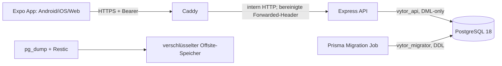

# Vytor – technischer Stack und Architektur

Stand: 21.10.2026, geprüft gegen Commit `cf4e9a257c5b670c0600bc35a844edd254bb97a9` plus uncommittete Audit-Änderungen.

## Systemübersicht



## Frontend

- Expo SDK 57.0.30, React Native 0.86.3, React 19.2.3, TypeScript 6.0.3; npm und `package-lock.json`, kein Bun.
- Expo Router 57: alle Screens liegen in `src/app/`, Navigatoren in `_layout.tsx`. Komponenten, Contexts, Hooks und Utilities liegen außerhalb des Route-Verzeichnisses.
- `WorkoutProvider` ist der zentrale Workout-Zustand. Theme und Dialoge haben eigene Contexts. Es gibt keinen Redux-/Query-Cache.
- `src/services/api.ts` kapselt Fetch, 15-Sekunden-Abbruch, Bearer-Header, Session-Reaktion und API-Verträge. Release-JavaScript akzeptiert nur eine explizite HTTPS-URL.
- Workout-Drafts liegen kontogetrennt in AsyncStorage. Schreibvorgänge sind geordnet; App-Hintergrund und Draft-Wechsel lösen einen Flush aus. Server-Sync verwendet Optimistic Concurrency über `Workout.revision`.
- Native Tokens: `expo-secure-store` 57.0.4, ohne Klartext-Fallback. Web: tabgebundenes `sessionStorage`, daher XSS-abhängig und nicht dauerhaft. Nicht geheime Benutzer-ID, Theme und Drafts bleiben in AsyncStorage.
- Themes: `ThemeContext`, zentrale Farben/Layout-Tokens in `src/constants/theme.ts`. UI-Hauptkomponenten liegen in `src/components/`.

## Backend

- Node.js-Zielimage 22.23.3, Express 5.2.1, TypeScript, Prisma 7.10.1, `@prisma/adapter-pg`, `pg`, `bcryptjs` (Cost 12).
- Eine Express-Anwendung in `server/src/index.ts`; Validierung in `workout-validation.ts` und `validation.ts`, Sicherheitsmiddleware in `security.ts`, XP/Level in `progression.ts`.
- 64-Byte-Hex-Bearer-Tokens entstehen aus 32 Zufallsbytes; nur SHA-256-Hashes werden mit 30 Tagen Ablauf gespeichert. Passwortwechsel widerruft alle Sessions; Logout widerruft die aktuelle.
- Produktion vertraut exakt einer konfigurierten Caddy-IP. Browser-CORS ist standardmäßig aus und kann für genau einen HTTPS-`WEB_ORIGIN` freigegeben werden; kein Wildcard-Origin. JSON ist auf 3 MB und strukturelle Tiefe/Knoten begrenzt. Fehlerantworten enthalten allowlist-basierte Codes und Request-ID statt Datenbankdetails.
- Login-, Registrierungs- und Passwortprüfungen haben IP-/Account-Budgets im Prozessspeicher. Das passt zu genau einer API-Instanz; horizontale Skalierung benötigt einen gemeinsamen Limiter.
- Produktion ist standardmäßig für Registrierung geschlossen. Optional erlaubt der SHA-256-Hash eines privaten Beta-Codes die Registrierung; der Klartextcode gehört nicht in Git oder Expo-Variablen.
- Kritische Abschluss-, XP-, Freundschafts- und Strukturübergänge verwenden Transaktionen, bedingte Updates und teilweise PostgreSQL Advisory Locks.

## Datenbank

- PostgreSQL 18.6 ist lokal im isolierten Harness nachgewiesen; CI verwendet noch PostgreSQL 17.
- Zentrale Modelle: User/Session, Exercise/ExercisePreference, Workout/WorkoutExercise/WorkoutSet, WorkoutTemplate, FriendRequest, XpEvent und Feedback.
- Ein partieller Index erlaubt ein aktives Workout je Nutzer. Revisionen schützen Draft und Workout-Struktur. `XpEvent.workoutId` ist eindeutig. `WorkoutSet.dropSetOfId` bildet stabile Drop-Set-Ursprünge ab.
- Ein funktionaler Unique-Index auf `lower(username)` verhindert Case-Races. Die Migration bricht bei vorhandenen Kollisionen ab, statt Daten automatisch umzubenennen.
- Rollen: Clusteradministrator nur für Initialisierung/Restore; `vytor_migrator` besitzt Schema/DDL; `vytor_api` erhält ausschließlich Connect, Schema-Usage sowie Tabellen-DML und Sequenznutzung.
- Migrationen liegen versioniert unter `server/prisma/migrations/`; Produktion verwendet `prisma migrate deploy` im separaten Migration-Image.

## Infrastruktur

- `compose.production.yml`: PostgreSQL, read-only/non-root API, separates Migration-Target und Caddy; nur 80/443 werden veröffentlicht. DB-Netz ist intern. Ressourcen, PIDs, Logrotation, Healthchecks und Capabilities sind begrenzt.
- Caddy übernimmt automatisches TLS, 3-MB-Bodylimit, aktive API-Readiness-Prüfung und ersetzt Forwarded-Header. Express akzeptiert nur die feste Caddy-Adresse als Proxy.
- Secrets liegen in der nicht versionierten `.env.production` bzw. `/etc/vytor/backup.env`. Clientvariablen sind öffentlich und dürfen keine Secrets enthalten.
- Backups: PostgreSQL-Custom-Dump, Restic-Verschlüsselung und externe Ablage, 14 tägliche Stände. Der Datenbankdump/Restore ist lokal geprüft; Restic/Provider/Timer sind auf echter Infrastruktur noch nicht abgenommen.
- Native Verteilung erfolgt separat über EAS. Hetzner stellt API/DB/Proxy bereit, nicht die App-Binaries.

## Beispielabläufe

```mermaid
sequenceDiagram
  participant App
  participant API
  participant DB
  App->>API: Login(username,password)
  API->>DB: bcrypt prüfen; Session-Hash speichern
  API-->>App: einmaliges Bearer-Token
  App->>App: SecureStore (native) / sessionStorage (web)
  App->>API: Workout starten
  API->>DB: aktives Workout + Übungen
  App->>App: Satz ändern; lokalen Snapshot geordnet schreiben
  App->>API: PUT draft(revision N)
  API->>DB: UPDATE ... WHERE revision=N; revision++
  alt Konflikt
    API-->>App: 409; lokale Daten bleiben erhalten
  else Erfolg
    API-->>App: revision N+1
  end
  App->>API: Finish(revision N+1)
  API->>DB: Lock; Sets + Drop-Referenzen + XP atomar
```

Templates speichern Übungsreihenfolge und Zielkonfiguration. Freundschaftsanfragen wechseln atomar aus `PENDING`; nur akzeptierte Freunde sehen exakte Workout-Zeitpunkte und Details. XP wird einmal pro Workout als 100 Basis plus 10 je abgeschlossenem Nicht-Warm-up-Satz vergeben; Frequenzgrenzen reduzieren automatisierten Missbrauch, beweisen aber keine reale Trainingsleistung.

Wichtige Einstiege: `README.md`, `server/src/index.ts`, `src/context/workout-context.tsx`, `src/services/api.ts`, `docs/DEPLOYMENT_RUNBOOK.md` und `docs/CODEX_REVIEW_HANDOFF.md`.
